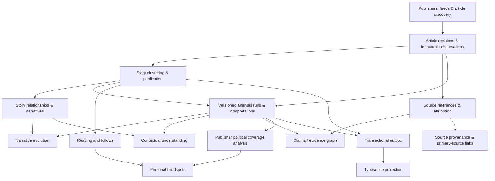
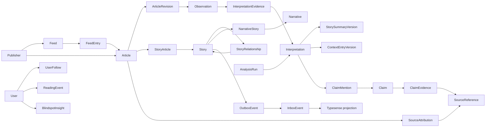
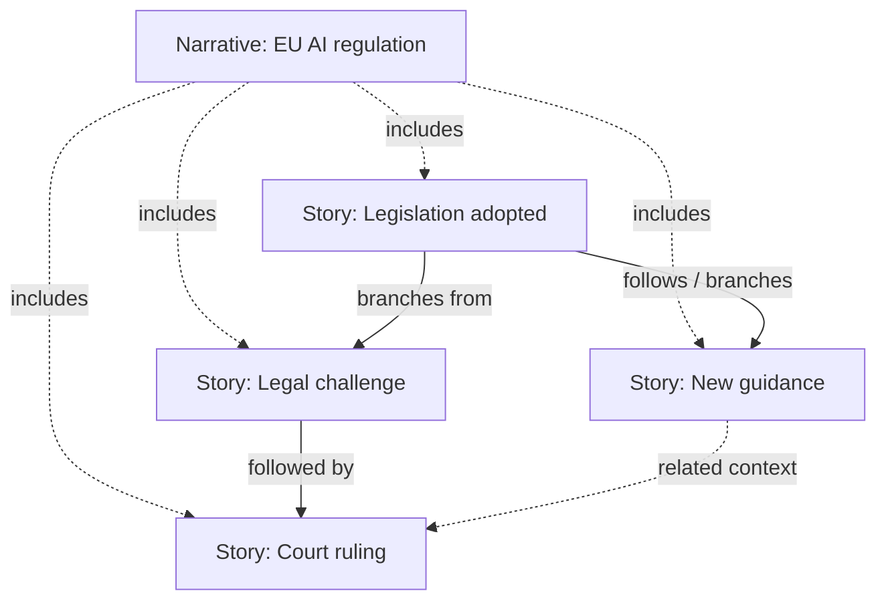
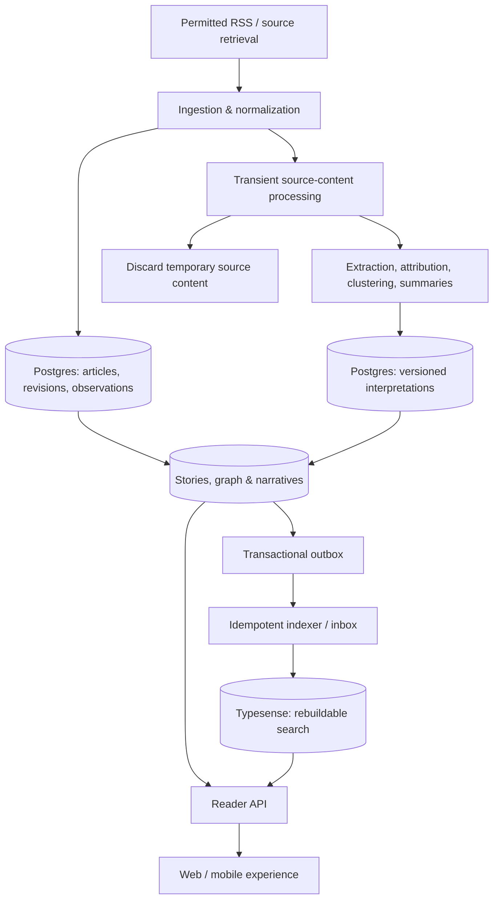

# News Intelligence Platform — Architecture & Data Model

> **Historical plan.** Written before building. Where it differs from the code, [006](006-implementation-notes.md) and [`AGENTS.md`](../AGENTS.md) are current.

**Status:** Agreed working design (v0.3)  
**Date:** 2026-10-10  
**Scope:** Product data model and logical architecture. Physical infrastructure and deployment design are deliberately deferred.  
**Format:** TypeScript-like pseudocode; not final database DDL or ORM schema.

## 1. Product intent

A carefully designed web/mobile news-reading product centered on original AI-generated, source-linked summaries and political/media analysis. A **Story** is a discrete, publishable news development. **Narratives** connect developments over time. User-facing analysis must be traceable to captured **Observations** without asserting that all reported claims are true.

### Selected differentiators (unordered)

1. **Narrative Evolution:** Browse how developments, reporting, claims, and corrections evolve and branch.
2. **Contextual Understanding:** Optional inline definitions, background, and prerequisite-story previews.
3. **Claims / Evidence Graph:** Connect distinct claims to their mentions and relevant supporting, contradicting, or contextual sources.
4. **Source Provenance:** Distinguish attributed original reporting, syndication, explicit citations, and inferred derivation.
5. **Personal Blindspots:** Show gaps in a user's reading, missed updates, and underexplored perspectives without inferring their political affiliation.
6. **Primary-Source Integration:** Discover and link out to original studies, legislation, court documents, datasets, etc. No integrated document viewer required.

**Foundational product:** Polished story-first reading, concise AI summaries, story clustering, and transparent publisher/coverage political analysis. Summary presentation (bullets versus paragraphs, possibly configurable) is not yet decided.

## 2. Decisions and invariants

| Area | Decision |
| --- | --- |
| Publication unit | **Story** is the canonical item in feeds, search, notifications, sharing. |
| Publishing constraint | Published Story must have **at least one traceable source Article**. Enforce at service/transaction boundary; consider DB enforcement later. |
| Granularity | Stories represent discrete developments; do not force all related articles into one giant story. |
| Narrative | A Narrative groups multiple Stories, potentially many-to-many and optionally created later. |
| Relationships | Typed, directional Story graph; not restricted to a tree. Multiple parents and cross-links permitted; prohibit invalid cycles for temporal/causal relations. |
| Merge and split | Supported explicitly with recorded operations, persistent identifiers and historical link resolution. |
| Source retention | **Never persist full third-party article bodies** in application storage, worker queues, logs, backups, or search. Temporary permitted processing only; respect source terms. Metadata/headlines/descriptions only where permitted. |
| Summaries | Original AI-generated Story summaries; editable by humans via new immutable versions. No silent overwrite. |
| Observations | Append-only/immutable records of *what was encountered*, not proof that the source's statement is true. Supersession/correction are new records; legal/privacy deletion may still be required. |
| Interpretations | Versioned outputs linked to observations and analysis runs. Separate observed facts from model inference. |
| Source grounding | Every material published assertion should link to relevant observations/source references, with evidence quality and uncertainty represented honestly. |
| Publisher bias | Versioned, evidence-based publisher assessments, separate from article-level framing and factual reliability. Context/rubrics depend on geography. |
| Database | PostgreSQL canonical source of truth; pgvector initially for similarity as needed. |
| Search | **Typesense** as a distinct, rebuildable search projection supporting filtering, typo-tolerant and vector/hybrid search. Never canonical storage. |
| Index updates | PostgreSQL transactional **outbox**; idempotent consumers using **inbox**/processed-event records. Handle out-of-order events and deletes. |
| Infra | Self-hosted/bare-metal-first, provider-portable deployment and IaC are requirements. Detailed IaC/server/GPU plan postponed until data model is settled. |
| Simplicity | Begin with small stable schema; add advanced claims/evidence and personal insights incrementally. |

**Important qualification:** Avoiding full-text storage reduces some retention concerns but does not itself resolve permission, copyright, contractual, or AI-processing obligations. Source URLs and content hashes alone cannot always independently verify historic content after a publisher changes it.

## 3. Logical dependency map



## 4. Entity relationship sketch



Arrows represent conceptual references/dependencies, not FK direction or cardinality. The join tables carry many-to-many relations; `StoryRelationship` is an edge between two stories.

## 5. TypeScript-like data model

Common aliases:

```ts
type ID = string;
type Timestamp = string; // UTC ISO timestamp
type URL = string;
```

### 5.1 Source content and ingest

```ts
interface Publisher {
  id: ID;
  name: string;
  domain: string;
  countryCode?: string;
  languages: string[];
  createdAt: Timestamp;
}

interface Feed {
  id: ID;
  publisherId: ID;
  url: URL;
  enabled: boolean;
  lastPolledAt?: Timestamp;
}

// Tracks discovery via a particular feed (an Article may have multiple).
interface FeedEntry {
  id: ID;
  feedId: ID;
  articleId: ID;
  externalGuid?: string;
  firstSeenAt: Timestamp;
  lastSeenAt: Timestamp;
}

interface Article {
  id: ID;
  publisherId: ID;
  canonicalUrl: URL;
  firstSeenAt: Timestamp;
  publishedAt?: Timestamp;
  latestRevisionId?: ID;
}

interface ArticleRevision {
  id: ID;
  articleId: ID;
  observedAt: Timestamp;
  reportedUpdatedAt?: Timestamp;
  title: string;
  description?: string; // only if use permitted
  contentHash?: string; // detection only, not recoverable source text
  previousRevisionId?: ID;
}
```

Store new revisions only for meaningful observed changes to tracked metadata. Do not promise article-body diffs without permitted retained supporting material. Canonical-URL normalization and article deduplication need explicit implementation rules.

### 5.2 Observations, interpretations, and their grounding

```ts
type ObservationType =
  | "article_discovered"
  | "article_revision_detected"
  | "source_citation_found"
  | "primary_document_found"
  | "correction_notice_found"
  | "publisher_statement_found";

interface Observation {
  id: ID;
  type: ObservationType;
  observedAt: Timestamp;
  sourcePublishedAt?: Timestamp;
  sourceUrl: URL;
  collectionMethod: "rss" | "web" | "api" | "manual";
  subjectType: "article" | "document" | "publisher";
  subjectId: ID;
  payload: Record<string, unknown>; // type-validated & schema-versioned
  schemaVersion: number;
}

interface Interpretation {
  id: ID;
  type: string;
  output: Record<string, unknown>; // validated by interpretation type
  analysisRunId: ID;
  createdAt: Timestamp;
  supersedesInterpretationId?: ID;
}

interface InterpretationEvidence {
  interpretationId: ID;
  observationId: ID;
  relationship: "derived_from" | "supports" | "contradicts" | "context";
}
```

**Semantics:** “Article X reports Y” may be an observation. “Y happened” is a claim requiring evaluation. “Y is historically significant” is an interpretation. Append-only observations may be followed by correction/supersession records; they are not rewritten to fit new conclusions.

### 5.3 Stories, revisions, graph, and narratives

```ts
interface Story {
  id: ID;
  title: string; // public current title (versioned presentation recommended)
  createdAt: Timestamp;
  firstObservedAt: Timestamp;
  lastUpdatedAt: Timestamp;
  status: "developing" | "ongoing" | "dormant";
  currentSummaryId?: ID;
}

interface StoryArticle {
  id: ID;
  storyId: ID;
  articleId: ID;
  addedAt: Timestamp;
  removedAt?: Timestamp;
  confidence?: number;
  analysisRunId?: ID;
}

type StoryRelation =
  | "follows"
  | "branches_from"
  | "responds_to"
  | "corrects"
  | "provides_context_for"
  | "related_to";

interface StoryRelationship {
  id: ID;
  fromStoryId: ID;
  toStoryId: ID;
  relation: StoryRelation;
  createdAt: Timestamp;
  supersededAt?: Timestamp;
  analysisRunId?: ID;
  confidence?: number;
}

interface Narrative {
  id: ID;
  title: string;
  description?: string;
  createdAt: Timestamp;
}

interface NarrativeStory {
  narrativeId: ID;
  storyId: ID;
  addedAt: Timestamp;
  removedAt?: Timestamp;
}

// Proposed for explicit merge/split operations; exact event schema TBD.
interface StoryLineageEvent {
  id: ID;
  kind: "merged" | "split";
  fromStoryIds: ID[];
  toStoryIds: ID[];
  occurredAt: Timestamp;
  reason?: string;
  analysisRunId?: ID;
}

// Immutable summary versions are interpretations; keep a public pointer.
interface StorySummaryVersion {
  id: ID;
  storyId: ID;
  interpretationId?: ID; // optional for human-authored correction
  body: string;
  format: "paragraph" | "bullets";
  createdAt: Timestamp;
  supersedesVersionId?: ID;
  editedByUserId?: ID;
}
```

**Story graph conventions:** `follows`/`branches_from`/`responds_to` edges must have documented directionality and temporal validation. `related_to` may be symmetric at application level. A Story can belong to multiple Narratives. A Narrative need not exist when the Story is first created. A published Story must have at least one active source-linked `StoryArticle`.



### 5.4 Claims, evidence, context, and provenance

These interfaces are **expansion-ready designs**, not all required for the first migration.

```ts
interface Claim {
  id: ID;
  proposition: string;
  createdAt: Timestamp;
  canonicalClaimId?: ID;
}

interface ClaimMention {
  id: ID;
  claimId: ID;
  articleRevisionId: ID;
  stance: "asserts" | "denies" | "quotes" | "discusses";
  observationId?: ID;
  analysisRunId: ID;
}

interface SourceReference {
  id: ID;
  url: URL;
  title?: string;
  kind:
    | "publisher_article"
    | "primary_document"
    | "dataset"
    | "official_statement"
    | "other";
  discoveredAt: Timestamp;
}

interface ClaimEvidence {
  id: ID;
  claimId: ID;
  sourceReferenceId: ID;
  observationId?: ID;
  relationship: "supports" | "contradicts" | "context" | "inconclusive";
  analysisRunId: ID;
}

interface ContextEntry {
  id: ID;
  kind: "definition" | "background" | "prerequisite";
  title: string;
  currentVersionId: ID;
}

interface ContextEntryVersion {
  id: ID;
  contextEntryId: ID;
  explanation: string;
  interpretationId: ID;
  createdAt: Timestamp;
}

interface StoryContext {
  storyId: ID;
  contextEntryId: ID;
  relationship: "defines" | "explains" | "prerequisite";
}

interface SourceAttribution {
  id: ID;
  articleId: ID;
  sourceArticleId?: ID;
  sourceReferenceId?: ID;
  relation:
    | "explicitly_cites"
    | "syndicated_from"
    | "based_on"
    | "possibly_derived_from";
  detectionMethod:
    | "explicit_credit"
    | "hyperlink"
    | "semantic_inference"
    | "manual";
  observationId?: ID;
  analysisRunId?: ID;
}

interface PublisherAssessment {
  id: ID;
  publisherId: ID;
  countryContext: string;
  assessmentPeriodStart: Timestamp;
  assessmentPeriodEnd: Timestamp;
  dimensions: Record<string, {
    assessment: string;
    confidence: number;
    rationale: string;
    supportingArticleIds: ID[];
  }>;
  methodologyVersion: string;
  analysisRunId: ID;
  createdAt: Timestamp;
  reviewedAt?: Timestamp;
}
```

`SourceAttribution`: exactly one of `sourceArticleId` and `sourceReferenceId` should be set. Explicit citations are not equivalent to independent corroboration. Political orientation, factual reliability, and article-level framing are separate analyses.

### 5.5 Users and personalization

```ts
interface User {
  id: ID;
  createdAt: Timestamp;
}

interface UserFollow {
  id: ID;
  userId: ID;
  targetType: "story" | "narrative" | "publisher" | "topic";
  targetId: ID;
  createdAt: Timestamp;
}

interface UserPreference {
  userId: ID;
  contextLevel: "minimal" | "balanced" | "deep";
  summaryFormat?: "bullets" | "paragraph"; // presentation TBD
}

interface ReadingEvent {
  id: ID;
  userId: ID;
  storyId: ID;
  articleId?: ID;
  eventType: "opened" | "read" | "saved";
  occurredAt: Timestamp;
}

interface BlindspotInsight {
  id: ID;
  userId: ID;
  type: "missing_perspective" | "missed_development" | "underexplored_topic";
  relatedStoryIds: ID[];
  explanation: string;
  createdAt: Timestamp;
  expiresAt?: Timestamp;
}
```

Minimize/limit reading-event retention; make personalization appropriately consent-based. Reading behavior is not a reliable proxy for personal political affiliation.

### 5.6 Processing and search indexing

```ts
interface AnalysisRun {
  id: ID;
  operation: string;
  modelId: string;
  promptVersion: string;
  inputFingerprint: string;
  startedAt: Timestamp;
  completedAt?: Timestamp;
  status: "running" | "succeeded" | "failed";
}

interface OutboxEvent {
  id: ID;
  aggregateType: string;
  aggregateId: ID;
  eventType: string;
  aggregateVersion: number;
  payload: Record<string, unknown>;
  createdAt: Timestamp;
  processedAt?: Timestamp;
}

interface InboxEvent {
  consumer: string;
  eventId: ID;
  processedAt: Timestamp;
}

// Rebuildable Typesense document / indexer projection, not canonical DB data.
interface SearchProjection {
  id: ID;
  type: "story" | "narrative" | "publisher" | "claim" | "context";
  title: string;
  text: string; // own generated material & approved metadata only
  embedding?: number[];
  updatedAt: Timestamp;
  version: number;
}
```

**Transaction boundary:** canonical write + outbox insert in one Postgres transaction. Indexer uses at-least-once delivery with idempotent upserts and per-aggregate monotonic versions; delete/withdrawal events remove entries. Full Typesense index reconstruction must be possible from Postgres.

## 6. Processing/data-flow diagram



A future independent GPU inference service is compatible with this design; it is not required by the data model. AI enrichment must be rerunnable without re-ingesting feeds, to the extent permitted source data remains available.

## 7. Phase boundaries and scope control

### Initial implementation schema (core)

- Publisher, Feed, FeedEntry
- Article, ArticleRevision
- Observation
- Story, StoryArticle, StoryRelationship
- Narrative, NarrativeStory
- Versioned Story summary / Interpretation, AnalysisRun (lean initial forms)
- SourceReference and basic explicit SourceAttribution
- Transactional OutboxEvent and indexer InboxEvent
- User / UserFollow only if accounts/following ship in v1

### Deferred until justified

- Claim canonicalization, ClaimMention, advanced ClaimEvidence relations
- Sophisticated independent-reporting-chain inference
- Rich article framing analysis and publisher assessment dimensions
- ContextEntryVersion personalization and reusable context graph sophistication
- BlindspotInsight storage/computation
- Large-scale automated narrative restructuring
- Detailed lineage audit UX, beyond minimal recorded merge/split operations
- Specialized graph database or complex distributed streaming infrastructure

**Capture now, display later:** source URLs, observation timestamps, permitted revision metadata, immutable evidence links and analysis versions. These cannot always be reconstructed retroactively.

## 8. Concrete rules to implement when converting to SQL/ORM

1. Stable IDs, foreign keys, unique constraints for normalized URLs/identities, and indexes on `observedAt`, `publishedAt`, and relationship endpoints.
2. `ArticleRevision` append-only; `Article.latestRevisionId` must point to its own revision. Prevent mutation of previously published summary versions.
3. Published Stories require at least one active `StoryArticle` linked to an Article with a source URL.
4. Record story merges/splits and maintain aliases/redirects for old public routes; avoid dangling story links.
5. Enforce valid `StoryRelationship` direction, forbid self-edges and invalid temporal cycles; define whether symmetric edges are stored once.
6. Enforce the exactly-one-source-target constraint for SourceAttribution.
7. Validate observation payload and interpretation output by kind and schema version; no unbounded accidental full-text retention.
8. Add human-override provenance and superseding versions rather than modifying historical generated content.
9. Ensure cross-type evidence references are consistent and every public assertion can resolve its backing observation(s) where feasible.
10. Implement outbox retry/dead-letter handling, inbox dedupe, monotonic index versions, and full index rebuild tooling.
11. Set privacy retention, deletion, and data-access rules for reading events; explicitly handle removal despite immutable-event design.
12. Define operational source permissions for ingestion, inference, display, and metadata retention.

## 9. Open implementation choices (not blockers to data model sign-off)

- Concrete SQL schema / Drizzle conventions and migration strategy.
- Summary default: bullets, short paragraphs, or user-configurable presentation.
- Exact criteria and algorithm for story boundaries, merging, splitting, and narrative membership.
- Data shape for story-summary citations to specific observations, beyond basic join references.
- Typesense index collections, embeddings provider/model, hybrid ranking weights, and multilingual analysis.
- Whether editorial/human edits are stored as a special Interpretation subtype or separate SummaryVersion lineage.
- Source retrieval and ephemeral processing permissions, retention limits, and legal review.
- Server/OS/GPU choices and provider-specific IaC: explicitly reserved for next architectural discussion.

## 10. Architecture sign-off note

All substantive data-model decisions recorded above were agreed in conversation. New pseudocode types that make implied behavior explicit (`StoryLineageEvent`, `StorySummaryVersion`, `UserFollow`) are *design proposals* pending refinement in schema implementation, not a claim that their exact fields were individually approved.
