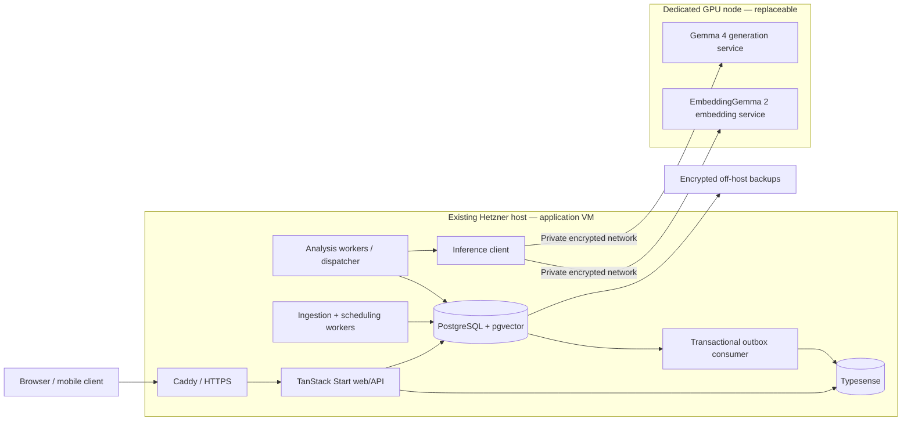
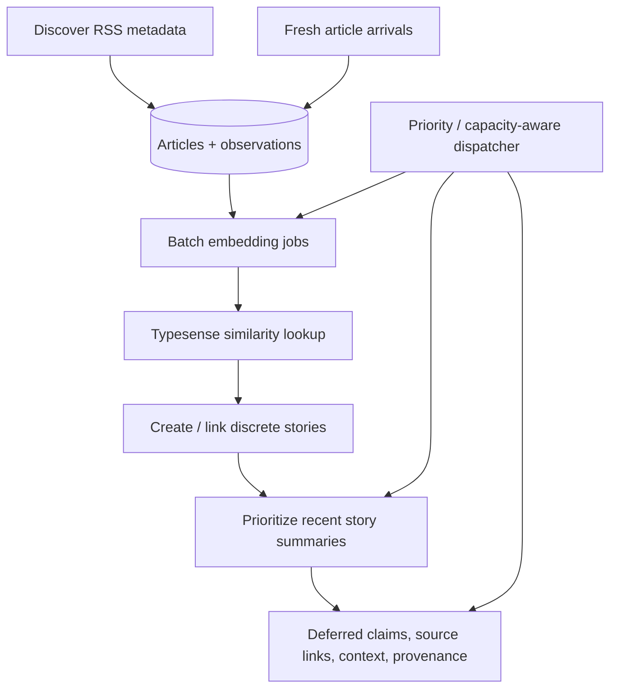

# News Intelligence Platform — Infrastructure & Deployment Architecture

> **Current setup first.** [Production setup](#production-setup) below is canonical. Sections 1–10 are the plan written before building; where they differ, the production setup, [006](006-implementation-notes.md) and [`AGENTS.md`](../AGENTS.md) are current.

## Production setup

Live at **https://domino-wire.ndo.dev** since 2026-10-10.

```text
Browser ──► Cloudflare (DNS, proxy, TLS) ──► Traefik (separate machine) ──► Docker host 10.0.22.64:4000
                                                                             └─ Proxmox LXC running the Compose stack
Docker host ──► inference server (plain HTTP over Tailscale)
```

- **Docker host:** a Proxmox LXC with Docker and git; no Node needed. It runs the whole Compose stack from `infra/compose/compose.yaml`: `postgres`, `typesense`, `migrate` (one-off), `web`, `worker`, `indexer`.
- **Ingress:** Traefik on another machine receives the proxied traffic and forwards to the web container. So `.env` sets `WEB_BIND=10.0.22.64` (the LXC's LAN address); the default `127.0.0.1` would be unreachable from Traefik. Postgres and Typesense stay on `127.0.0.1`.
- **Firewall:** the Proxmox firewall must allow port 4000 to the LXC. A block there shows up as a Cloudflare 504.
- **Inference:** `INFERENCE_MODE=local`, with `INFERENCE_BASE_URL` pointing at the inference server over Tailscale. Tailscale encrypts the link, so plain HTTP is fine and `INFERENCE_CA_CERT` stays empty.
- **Auth:** `BETTER_AUTH_URL=https://domino-wire.ndo.dev`. Set `AUTH_IP_HEADERS=cf-connecting-ip` only if the origin accepts traffic from Cloudflare alone; otherwise the header can be spoofed.
- **Deploy and update:** `scripts/deploy.sh up` the first time, then `scripts/deploy.sh update` (pull, rebuild, migrate, restart, re-seed). `scripts/deploy.sh user <name>` creates an admin login.
- **Not set up yet:** off-host backups and monitoring.
- **Troubleshooting order for a 5xx:** container status (`scripts/deploy.sh status`), `WEB_BIND`, the Proxmox firewall, then Traefik.

**Status:** Agreed working architecture; operational details pending  
**Version:** v0.1  
**Date:** 2026-10-10  
**Companion docs:** `001-data-model.md` (data model), `003-application-stack.md` (software architecture)

## 1. Goals and constraints

- Launch using a **VM on an existing Hetzner bare-metal host** with sufficient capacity for the conventional application stack.
- Deploy the application as a **portable Docker Compose stack**. Do not couple its runtime to Hetzner-specific APIs.
- Host open-weight inference on a **separate, replaceable GPU node**. The GPU node is stateless in the application sense: model weights/caches may be local, but not canonical records or durable jobs.
- Prefer simple, operable infrastructure for a one-person team; avoid Kubernetes or a separate message broker initially.
- **OpenTofu** is the chosen provisioning IaC tool for *new* infrastructure as needed. No requirement to retroactively provision or import the existing bare-metal server.
- Protect persistent state with **off-host encrypted backups** and restore testing.
- Remain deployable on other providers or user-owned hardware.

## 2. Topology



**Logical view:** pg-boss stores durable jobs within Postgres, not as a separate queue server. Models are invoked over a private network, not exposed to the public internet. Docker Compose service layout does not imply a separate VM per service.

## 3. Deployment responsibilities

| Layer | Choice | Responsibility |
| --- | --- | --- |
| Existing physical host | Hetzner bare metal, already owned | Capacity and underlying VM hosting; not reprovisioned for this project |
| Application host | Linux VM | Persistent application and search data, ingress, workers |
| Application deployment | Docker Compose | Web, workers, PostgreSQL, Typesense, indexer, monitoring/proxy |
| GPU host | Separate GPU node | Model-serving runtimes and weights; no canonical app state |
| Provisioning IaC | OpenTofu | Future GPU server/cloud VM, networks, DNS/firewalls where supported |
| Host configuration | Ansible | OS setup, Docker, networking/security, GPU drivers, backup prerequisites |
| Private connectivity | WireGuard or Tailscale (not yet selected) | Application-to-GPU API access |
| Backup destination | Off-host object storage or backup host (not yet selected) | Encrypted backups outside source server failure domain |

### Important portability boundary

OpenTofu modules are provider-specific where necessary, but host roles, Compose manifests, application images, database migrations, and inference API contracts remain provider-agnostic. Hetzner Cloud's official provider does **not** provision dedicated Robot machines; Robot/bare-metal setup may require a community provider plus separate OS installation automation. We will evaluate exact providers when creating the GPU node.

## 4. Application VM — deployed services

```text
app-vm
  caddy             # TLS termination / reverse proxy
  web               # TanStack Start application
  worker            # feed polling, enrichment and inference dispatcher
  indexer           # PostgreSQL outbox -> Typesense
  postgres          # authoritative state + pgvector + pg-boss tables
  typesense         # derived search and vector index
  monitoring        # lightweight logs, metrics and health endpoints
```

`web`, `worker`, and `indexer` may reuse shared monorepo packages or a common build image while running as separate processes. This is a conceptual list, not a final Compose manifest.

## 5. GPU node contract and failure boundary

- Two logical APIs: **generation** (Gemma 4) and **embeddings** (EmbeddingGemma 2).
- The application owns task queues, job status, result validation, retries, publisher data, and saved analysis artifacts.
- Model servers own only loaded weights, ephemeral request execution, and disposable caches.
- Model endpoints are reachable **only across private authenticated/encrypted connectivity**; add transport or service authentication as appropriate.
- Endpoint URLs are configuration, not hard-coded dependencies.
- A GPU outage must **not** take down browsing, previously published stories, PostgreSQL, or Typesense. Pending analysis stays durable and resumes after service restoration.
- GPU capacity/backpressure policy lives in the application-side dispatcher, informed by measured capacity and server metrics; no unbounded request flooding.
- Commercial/frontier inference is **only a disabled, lightly stubbed optional adapter**. All supported tasks default to local models.

## 6. Bootstrap and steady-state modes

The application must tolerate a very large initial batch without monopolizing the GPU or starving newer articles.



Agreed principles:

- Three job classes: **interactive**, **fresh**, **backfill**.
- **Backfill is pausable, rate-limited, and progressively admitted**; do not enqueue a massive set of expensive generation requests all at once.
- Process cheap ingestion/metadata first, then batched embeddings/clustering, then prioritized summaries, then optional enrichments.
- Limit inference concurrency separately for embeddings and generation; calibrate against actual hardware throughput and memory.
- Retries use capped exponential backoff and jitter; jobs are idempotent and analysis-version-aware.
- Outdated fresh-news jobs can expire or be reprioritized; stale results must not overwrite current analyses.
- Start with simple resource caps and backfill quotas; implement sophisticated weighted fairness only if measurements justify it.

## 7. Persistence, indexing and backups

- **PostgreSQL is the source of truth** for observations, stories/narratives, interpretations, users, jobs and transactional outbox.
- **Typesense is disposable/rebuildable** from approved PostgreSQL projections. It contains no original full article bodies.
- Database mutation and search outbox event must commit atomically; index consumers must tolerate duplicate/out-of-order events and deletions.
- Back up PostgreSQL with a tested point-in-time/recovery strategy appropriate to available storage. Encrypt and ship backups off-server; regularly perform test restores.
- Preserve only permitted source metadata and original generated summaries; **do not persist full third-party article bodies** in DB, search index, queues, logs, or backups.
- Run database migrations explicitly and take account of compatibility during rolling/restart deployments.

## 8. Operational visibility

Minimum useful measurements:

| Metric | Purpose |
| --- | --- |
| Queue depth and oldest pending age by priority/task | Detect starvation and backlogs |
| Discovery → publish latency | Primary freshness SLO candidate |
| Ingestion throughput; generation throughput | Understand bottlenecks |
| GPU utilization, memory/KV cache, latency and tokens/s | Tune capacity |
| Retry, timeout and terminal failure rates | Reliability |
| Index lag / outbox delivery age | Search freshness |
| Backup success and restore test age | Recovery readiness |

## 9. Open questions (not yet decided)

- VM sizing, operating system distribution and volume layout.
- Exact GPU hardware/VRAM, Gemma 4 variant/quantization, inference serving software and embedding placement (CPU vs GPU).
- WireGuard vs Tailscale, DNS/service discovery and secrets management.
- OpenTofu state backend, CI/CD and deploy/rollback process.
- Reverse proxy topology if the existing server already terminates TLS.
- Backup tooling, RPO/RTO, monitoring stack and alerting.
- Per-queue concurrency, batch sizes, retry budgets and bootstrap admission limits (benchmark-driven).

## 10. Decision log

| Decision | Status |
| --- | --- |
| Use existing Hetzner bare-metal capacity via an app VM | **Agreed** |
| Compose stack for core application | **Agreed** |
| GPU node separate and application-stateless | **Agreed** |
| Private connectivity between hosts | **Agreed**; product undecided |
| OpenTofu for future infrastructure provisioning | **Agreed** |
| Ansible for host configuration | **Working proposal** |
| Progressive bootstrap and priority-aware inference backpressure | **Agreed** |
| Cloud inference not required for v1 | **Agreed** |
| Exact monitoring/backup tools and GPU provisioning | **Deferred** |
