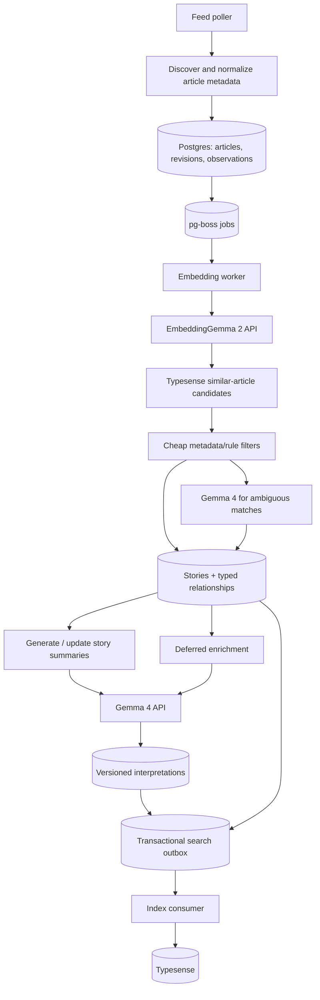
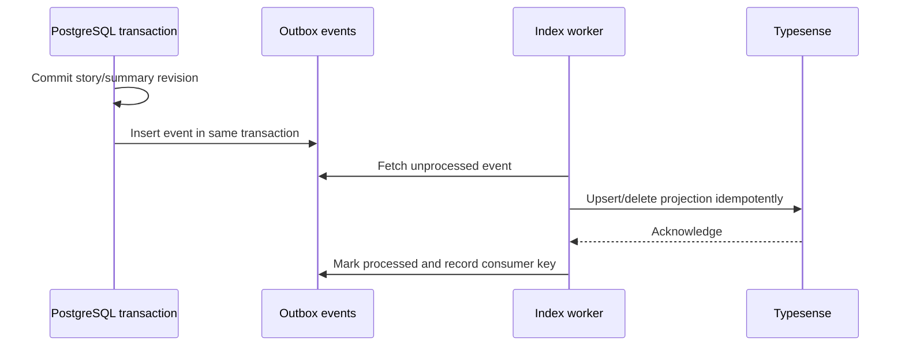

# News Intelligence Platform — Application Stack & Processing Architecture

> **Historical plan.** Written before building. Where it differs from the code, [006](006-implementation-notes.md) and [`AGENTS.md`](../AGENTS.md) are current.

**Status:** Agreed working stack; API and schema implementation details pending  
**Version:** v0.1  
**Date:** 2026-10-10  
**Companion docs:** `001-data-model.md` (canonical data model), `002-infrastructure.md` (deployment topology)

## 1. Selected stack

| Concern | Selection | Notes |
| --- | --- | --- |
| Full-stack framework | **TanStack Start** | Replaces earlier Next.js suggestion |
| Routing | **TanStack Router** | Framework ecosystem |
| Client server-state | **TanStack Query** | UI requests/caching; **not** durable background jobs |
| ORM / migrations | **Drizzle** | Working choice; final SQL constraints to follow |
| Canonical DB | **PostgreSQL** | Truth store for core domain, users, jobs and outbox |
| Vector DB capability | **pgvector** | Available for relational similarity use cases; avoid duplicate ownership with search |
| User-facing search | **Typesense** | Separate typo-tolerant, filtered and vector/hybrid search projection |
| Durable background jobs | **pg-boss** | Stored in PostgreSQL, retryable and separately consumed |
| Application language/runtime | **TypeScript / Node.js** | Shared types across web and workers |
| AI embeddings | **EmbeddingGemma 2** | Local embedding service on GPU node (CPU benchmark possible) |
| AI generation and decisions | **One Gemma 4 variant** | Shared local model for summaries, extraction, decisions, framing, etc. |
| Cloud LLM | Optional provider interface only | Disabled; no active escalation policy initially |
| Deployment | **Docker Compose** | Core stack on app VM; separate inference Compose stack |
| Authentication | **better-auth** | Whole app behind login; username/password, passkeys, optional Google, bearer tokens for API clients |

**TanStack Pacer:** process-local throttling/queuing tool, **not** the durable job queue. No need to include it initially; add only if a specific in-process control benefits from it.

## 2. Monorepo boundaries (proposed layout)

```text
apps/
  web/                 # TanStack Start: reader UI, server APIs/functions
  worker/              # pg-boss consumers, ingestion, inference dispatcher
  indexer/             # transactional outbox consumer -> Typesense
packages/
  db/                  # Drizzle schema, migrations and query helpers
  jobs/                # typed job definitions, schemas and enqueue helpers
  inference/           # inference task router, model adapters, validators
  search/              # Typesense projection and search API
  domain/              # Stories, Narratives, Observations, publisher logic
  shared/              # cross-cutting primitives/types
infra/
  compose/             # application / GPU stack manifests
  ansible/
  tofu/
docs/
  architecture/
```

This is organizational guidance rather than a hard requirement that each package be independently published.

## 3. Domain architecture (summary)

The authoritative entity definitions, TypeScript drafts, publication rules and conceptual dependency diagrams live in **`001-data-model.md`**. Key invariants:

- **Story** is the canonical publishable unit; every *published* Story has at least one traceable source Article.
- **Narrative** groups related Stories; typed Story-to-Story edges represent the branching history. Merges and splits are supported with historical identities retained.
- **Observation** is an immutable record of what was encountered, *not proof the reported assertion is true*.
- **Interpretation** and analysis outputs are versioned, traceable to observations and editable via new versions; avoid overwrites.
- No permanent full-text article ingestion: source content, where processing is authorized, is ephemeral. Store permitted metadata, links, structured evidence and generated original summaries.
- Political publisher assessments are evidence-based and versioned, distinct from article framing, factuality or user political preference.

## 4. Processing pipeline



Logical connections shown; implementation should not send uncommitted DB state directly to Typesense. Raw article bodies must not be embedded into durable job payloads or server logs.

### Progressive bootstrap

1. Discover, normalize and persist minimal permitted article metadata and observations.
2. Batch embeddings; retrieve similarity candidates through Typesense.
3. Form **discrete development Stories** and link them through typed graph edges; avoid aggressive global story merging.
4. Generate and publish summaries for *recent/relevant* Stories first.
5. Run claims, attribution, background context and other enrichment on spare capacity.

Backfill admission is gradual and independently pausable. Fresh-news jobs take priority without allowing unlimited starvation of backfill.

## 5. pg-boss job semantics

pg-boss is a PostgreSQL-backed execution mechanism; **Postgres owns durable state**, not the GPU node.

Proposed job types:

```typescript
export type JobName =
  | 'poll_feed'
  | 'normalize_article'
  | 'embed_article'
  | 'classify_story_match'
  | 'build_story_summary'
  | 'extract_claims'
  | 'extract_source_attribution'
  | 'discover_primary_sources'
  | 'generate_context'
  | 'analyze_publisher'
  | 'rebuild_search_projection';

export type JobClass = 'interactive' | 'fresh' | 'backfill';

export interface AnalysisJobPayload {
  targetId: string;        // reference persisted article/story/etc.
  inputFingerprint: string;
  pipelineVersion: string;
  priorityClass: JobClass;
  // Never store an article body or secret in durable payloads.
}
```

Invariants and policies:

- Jobs are **at-least-once**: consumers are idempotent, not dependent on exactly-once execution.
- A logical work key includes `task + target + input fingerprint + pipeline version` to suppress duplicates.
- Use **transactional enqueueing** when creating an article and its required analysis work; check actual pg-boss adapter/transaction API during implementation.
- A **capacity-aware dispatcher** limits concurrent generation and embedding requests independently, rather than assuming pg-boss priorities alone guarantee GPU fairness.
- Priorities: `interactive`, `fresh`, `backfill`. Start with simple concurrency ceilings and backfill quotas. Weights and aging are future tuning, not v1 scheduler complexity.
- Capped retries with jitter; expiry/deprioritization for obsolete work; bounded queues and backpressure during bootstrap.
- Only publish an output if it is based on the current relevant input version; stale successful jobs may be retained for analysis/audit but do not overwrite current content.
- Track oldest pending age and queue counts *per task and class*, not just global depth.

**Batching decision:** Keep **logical jobs granular** (per article, story or analysis unit). Batch compatible inference calls at dispatch time where serving APIs allow; do not sacrifice per-item idempotency/retry tracking.

## 6. Inference service abstraction

```typescript
export interface EmbeddingProvider {
  embed(input: { texts: string[]; task: string }): Promise<number[][]>;
}

export interface GenerationProvider {
  generate<T>(input: {
    task: string;
    promptVersion: string;
    payload: unknown;
    outputSchema: unknown;
  }): Promise<T>;
}

export interface InferenceRouting {
  embeddings: 'local';
  generation: 'local';
  optionalCloudProvider?: 'disabled' | 'configured'; // disabled in v1
}
```

Gemma 4 handles both generation and small typed decisions; there is **no separate 27B decision model**. Use constrained/structured outputs and runtime schema validation, with an explicit `uncertain` result when appropriate. Model/version/prompt/input references belong to saved analysis-run provenance.

Gemma 4 variant, quantization, serving runtime, per-request thinking settings, embedding execution placement and exact batching parameters remain benchmark-driven choices.

## 7. Typesense search projection and outbox/inbox

Typesense stores **searchable projections**, not canonical records. Search text consists of generated summaries and permitted metadata, optionally with embeddings; it can be fully rebuilt after loss or migration.



Constraints:

- Index consumer must handle duplicate delivery and out-of-order revisions; do not let an old event overwrite a newer document.
- Deletion/withdrawal events remove indexed documents.
- Search indexing failures do not roll back authoritative writes; index lag is measurable and repairable.
- Search reindexing is a separate replay/rebuild operation. Do not treat queue acknowledgments as proof that index state is correct.
- Search vectors use a known embedding-model/version/dimension contract. Changing models may require index rebuild or a parallel migration.
- **pg-boss jobs and the search transactional outbox are separate mechanisms**. A job being run is not the same as a committed domain event being indexed.

## 8. Reader application boundaries

- TanStack Start handles SSR, routing and server functions; TanStack Query manages client caching/invalidation.
- The web/API should not perform expensive analysis synchronously for ordinary page loads. Interactive analysis, if enabled, creates a bounded high-priority job with an explicit pending/result UI.
- Reads from PostgreSQL provide the canonical story and narrative data; Typesense returns candidate IDs/scores for discovery, filtering and retrieval.
- On a GPU outage, already published stories, narratives and search remain available; fresh processing visibly degrades instead of failing the site.
- Keep personally sensitive reading activity minimal and opt-in as needed; Personal Blindspots should not presume the reader's political beliefs.

## 8a. Authentication (better-auth)

Added 2026-10-10 by founder decision: **the entire application sits behind a login**, including Story and Narrative pages and every `/api/v1` route.

- **Library:** [better-auth](https://www.better-auth.com) with the Drizzle adapter. Auth tables (`auth_user`, `auth_session`, `auth_account`, `auth_verification`, `auth_passkey`) live in PostgreSQL next to domain data.
- **Methods:** username + password (`username` plugin), passkeys, and optional Google sign-in. Public sign-up is **disabled**; accounts are created with `pnpm cli user:create`, but any Google account can sign up.
- **Roles:** `auth_user.role` is `admin` or `user`. CLI accounts are admins unless `--role user`; Google accounts are users. API routes marked `adminOnly` return `403` to users.
- **API clients:** the `bearer` plugin issues a token on sign-in (`set-auth-token` header) that clients send as `Authorization: Bearer <token>`. The web app uses the same session via cookies. This keeps the API usable by the future Expo app without browser cookies.
- **Passkeys (implemented):** `@better-auth/passkey`. Signed-in users add passkeys on `/account`; the login page offers "Sign in with a passkey" and browser autofill. `rpID`/`origin` come from `BETTER_AUTH_URL`, so it must be the real public origin (HTTPS in production; `localhost` works for development).
- **Boundary:** `/api/auth/*` is served by better-auth; every `/api/v1/*` handler resolves the session first and returns a typed `401 unauthorized` error otherwise. Web route guards use a web-only server function to read the session, which the HTTP-first rule allows.
- **Secrets:** `BETTER_AUTH_SECRET` and `BETTER_AUTH_URL` are required configuration; `BETTER_AUTH_URL` must match the public origin.

## 9. Observability and test plan

- Product freshness: discovery → published-story latency, time since last successful ingest.
- Processing reliability: queue depth/age, retries, dead jobs, generation timeouts, stale-result rejections, backlog admission rate.
- Model performance: output validity, claim attribution errors, summarization omissions/hallucinations, clustering precision and recall, inference throughput.
- Search: outbox lag, index/document version mismatches, retrieval quality/recall, Typesense health.
- Build a held-out, source-backed evaluation set before relying on automated political/framing assessments; model confidence alone is not validation.

## 10. Decisions vs. outstanding details

### Agreed

- TanStack Start + Router + Query instead of Next.js.
- pg-boss for durable queuing; no separate queue broker in v1.
- PostgreSQL + Drizzle working stack; Typesense separate and rebuildable.
- Transactional outbox and idempotent inbox/consumer handling for indexing.
- Local EmbeddingGemma 2 and Gemma 4, without a dedicated decision model.
- Cloud/frontier inference stubbed but disabled; all tasks use local inference initially.
- Progressive bootstrap, bounded dispatch, priority classes and backpressure.
- Story/Narrative data semantics and Observation/Interpretation separation follow the canonical model doc.

### To benchmark or define during implementation

- Exact pg-boss schema/API and transactions, cron/feed polling setup and queue names.
- Model serving software, vLLM compatibility, hardware and quantization.
- Embedding input policy, vector dimensions, token/window limits and batching.
- Search projection mapping, mixed entity ranking, story/narrative filtering and index migration strategy.
- SLOs, queue limits, priority scheduling fairness, job expiry/retry budgets.
- Exact TypeScript schemas and Drizzle migrations.
