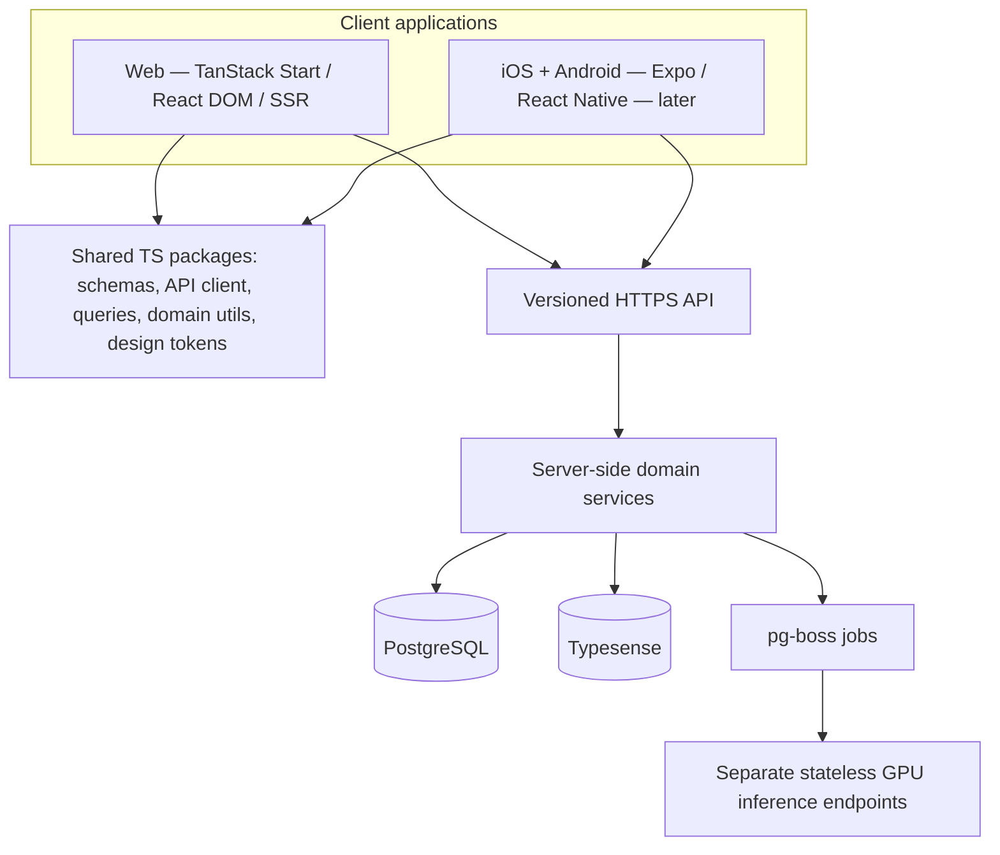

# 004 — Frontend Platform & API Boundary

**Project:** News Intelligence Platform  
**Version:** 0.3  
**Date:** 2026-10-10  
**Status:** Agreed architecture; implementation details remain open  
**Related:** `001-data-model.md`, `002-infrastructure.md`, `003-application-stack.md` (the previously created versioned architecture documents)

## 1. Decision summary

- **Supported product platforms:** Web, iOS, Android. Native desktop apps are **out of scope**.
- **First prototype:** Web only, with a first-class responsive web experience.
- **Web:** TanStack Start, TanStack Router, React DOM, and TanStack Query. Retain SSR for public, indexable Story and Narrative pages.
- **Future native apps:** Expo + React Native (iOS and Android), using Expo Router and native UI components.
- **No cross-platform component-sharing requirement:** Build the best UI for each platform. Share TypeScript contracts, data-access and query logic, domain utilities, and design tokens wherever practical.
- **Critical boundary:** Any domain operation or data needed by the future native app **must be exposed via an ordinary versioned HTTPS HTTP API**. Do not make TanStack Start server functions the only way to perform mobile-relevant actions.
- **Backend stays shared:** PostgreSQL, Typesense, pg-boss workers, inference services, and domain logic serve both web and native apps.
- **Not planned:** Capacitor, Electron, Tauri, or a webview-wrapped native application.

## 1a. Web styling and component development decisions

- **Styling:** Tailwind CSS v4, backed by centralized semantic CSS variables in `design-tokens.css` and mapped through Tailwind `@theme`. Final palette, typography and brand style are **not decided**.
- **Accessible primitives:** Base UI for interactions (popover, menu, dialog, etc.). Build original editorial presentation components; **do not install shadcn/ui** as the component system or imitate its default visual styling.
- **Component playground:** `seek-oss/playroom` is required for the prototype as a **development-only** tool. Configure shared tokens/global styles and representative typed fixtures and snippets; verify Tailwind v4 and Base UI work within Playroom. No Storybook alongside it.
- **Agent visual guardrails:** Avoid generic AI-generated SaaS presentation: purple/neon gradients, meaningless rainbow palettes, gratuitous pulsing badges, repetitive pill/fingernail cards, decorative emoji, careless alignment, default tech-template type styling, unnecessary glassmorphism, redundant copy and hype-driven slogans. Do not ban useful gradients, badges or color encoding on principle; each appearance should serve an editorial or data-communication purpose.
- **Visual direction:** Prioritize readable typography, source clarity, information hierarchy and purposeful density. Design choices are provisional and tokenized, not a finalized brand identity. Use semantic data-visualization colors where necessary (e.g. source categories) with accessible labels.
- **Development workflow:** Build components in isolation with Playroom fixtures, verify desktop and narrow-viewport behavior, then integrate them into product routes.
- **Reusable foundation components from the outset:** Build a small, original library for recurring primitives such as `Button`, `IconButton`, `TextInput`, `Textarea`, `Card`, `Badge`, `Popover`, and `Tooltip` as actual product needs emerge. Use Base UI for accessible behavior where it provides relevant primitives; use Tailwind v4 and semantic tokens for presentation. Do not introduce shadcn/ui or create a large abstract component framework speculatively.
- **Separate primitives from editorial UI:** Generic components have no Story/Publisher/Narrative dependencies. Compose them into domain-specific components such as `StoryCard`, `SourceIndicator`, `ContextAnnotation`, and `NarrativeTimeline`.
- **Playroom is the design iteration loop:** Create typed fixture snippets for each reusable component, explore sizes, variants, interaction states (including disabled, focus, error and loading where relevant), keyboard behavior, and desktop/narrow layouts; refine there before adoption across pages. Changes to common primitives should propagate throughout the app.


Design anti-pattern reference: https://godobject.dev/blog/10-tells-of-slop/ (September 27, 2026).

## 2. Goals and non-goals

### Goals

1. Ship a polished SSR-enabled web prototype quickly.
2. Allow a future Expo application to reuse API contracts and core client logic without restructuring the backend.
3. Keep all database access, inference orchestration, business rules, and background jobs on the server.
4. Share stable Story/Narrative identifiers and URLs across platforms.
5. Maintain a portable, testable HTTP boundary and explicit API error semantics.

### Non-goals for the first prototype

- Building, packaging, or submitting iOS/Android apps.
- Writing native navigation or React Native components now.
- Building a universal DOM/React Native component system.
- Implementing native push notifications, deep linking, offline-first storage, or app-store subscriptions now (but avoid contracts that preclude them).
- Desktop application support.

## 3. Platform architecture



The web app may call domain services directly **on the server during SSR**, but equivalent product capabilities must have an HTTP API route and cannot require invocation of a Start-specific server function. The mobile client never accesses databases, search credentials, or inference endpoints directly.

## 4. HTTP-first API rule (architectural invariant)

**Use conventional HTTPS API routes for any feature a mobile user could reasonably need**, even if only the web client exists today. Candidate domains include:

| Domain | Illustrative endpoints (not final route contracts) |
| --- | --- |
| Stories | `GET /api/v1/stories`, `GET /api/v1/stories/:id` |
| Narratives | `GET /api/v1/narratives/:id`, `GET /api/v1/narratives/:id/stories` |
| Search | `GET /api/v1/search?q=...` |
| Context | `GET /api/v1/stories/:id/context` |
| Sources/claims | `GET /api/v1/stories/:id/sources`, `GET /api/v1/stories/:id/claims` |
| Reader actions (later) | `PUT /api/v1/me/follows/:type/:id`, `POST /api/v1/me/reading-events` |

**These are examples**, not a commitment to endpoint granularity, identifiers, REST pagination shape, or a finalized auth scheme.

### Rules

- **One domain implementation:** Request handlers validate input, authenticate/authorize where needed, then call shared server-side services. Avoid duplicating logic in TanStack server functions.
- **Stable, typed contracts:** Define request/response/error payloads using Zod schemas in a shared package. Generate or infer TypeScript client types from these contracts.
- **Shared client:** Browser and Expo consume the same API through an isomorphic `fetch`-based client. Keep transport code independent of DOM and Node APIs.
- **Shared TanStack Query definitions:** Reuse query keys, `queryOptions`, mutation helpers and invalidation conventions where practical. SSR can prefetch/dehydrate these results.
- **Platform-specific auth transport:** Do not couple API calls exclusively to browser cookies or web-specific session APIs. Design for secure native credentials later; choose concrete session/token and CSRF details before implementing authenticated endpoints.
- **Do not ship server secrets to the client:** Clients call application HTTP endpoints, never PostgreSQL, Typesense admin APIs, pg-boss, or GPU inference endpoints.
- **Consistent API errors:** Standardize status codes, stable machine-readable error codes, validation errors and pagination. Support cancellation/timeouts via `AbortSignal` where appropriate.
- **SSR is retained:** Public Story/Narrative routes should render useful HTML for accessibility and discoverability, not become client-only just because mobile apps are planned.
- **API compatibility:** Version the public client surface (provisionally `/api/v1`); introduce additive changes where possible. Contract tests should detect breaking response changes.

### Server functions policy

TanStack Start server functions are **allowed** for strictly web-only conveniences or server-rendering orchestration. They should not be the sole entry point to shared product behavior. Prefer calling the same domain service behind an HTTP route. No need to artificially force server-side SSR code through a loopback HTTP request.

## 5. Proposed monorepo boundaries

```text
apps/
  web/                # TanStack Start, SSR, React DOM UI
  mobile/             # Expo + React Native (create later)
  worker/             # pg-boss consumers
packages/
  api-contracts/      # Zod request/response/error contracts
  api-client/         # Cross-platform HTTP transport
  queries/            # TanStack Query factories / hooks
  domain/             # Pure cross-platform types and utilities
  design-tokens/      # Shared visual constants, platform-adapted
  db/                 # Drizzle / database access (server only)
  server/             # Domain services and authorization (server only)
  inference/          # Inference adapters (server only)
  jobs/               # Job definitions / queue integration (server only)
infra/
  compose/            # Application and inference deployment manifests
```

Avoid requiring the initial agent to create empty packages with no purpose. Establish `api-contracts`, `api-client`, and clear server-only module boundaries early; extract additional packages as usage warrants.

### Example contract and client (illustrative pseudocode)

```ts
// packages/api-contracts/src/story.ts
import { z } from 'zod';

export const StorySummarySchema = z.object({
  id: z.string(),
  title: z.string(),
  summary: z.string(),
  sourceCount: z.number().int().nonnegative(),
});
export type StorySummary = z.infer<typeof StorySummarySchema>;

// packages/api-client/src/stories.ts
export function createApiClient(baseUrl: string, fetcher = fetch) {
  return {
    async getStory(id: string, signal?: AbortSignal) {
      const res = await fetcher(`${baseUrl}/api/v1/stories/${encodeURIComponent(id)}`, { signal });
      if (!res.ok) throw await toApiError(res);
      return StorySummarySchema.parse(await res.json());
    },
  };
}
```

`toApiError` is a placeholder for a shared error-normalization helper. The real contract should expose grounded sources, revisions, and other fields from the agreed domain model.

## 6. UX sharing strategy

| Shared across web/native | Implement separately |
| --- | --- |
| API contracts and domain types | React DOM components vs. React Native components |
| TanStack Query factories and data-fetching conventions | Layouts, menus, sheets, gestures, transitions |
| Date/number/text formatting and story-view models | Navigation shells (TanStack Router vs. Expo Router) |
| Design tokens and icon identity | Native accessibility and platform-specific presentation |
| Story and Narrative IDs / deep-linkable URL concepts | Complex graphs and rich content presentation |

A contextual definition may be a desktop popover but a native bottom sheet. Share the **meaning and data**, not necessarily the component tree.

## 7. Prototype acceptance criteria relevant to future mobile

- [ ] A Story can be fetched over a normal HTTP API route with no TanStack server-function dependency.
- [ ] A Narrative and its linked Stories can be fetched over normal HTTP API routes.
- [ ] Search uses a normal HTTP API route; Typesense credentials are never exposed to clients.
- [ ] Routes return Zod-conformant responses and standardized errors; contracts have automated tests.
- [ ] The web reader uses the reusable HTTP client / TanStack Query logic for client-side data access.
- [ ] Web SSR remains available for public Story/Narrative pages, and SSR does not duplicate domain logic.
- [ ] Shared client packages can compile in a non-browser, non-Node-specific TypeScript target (future Expo-compatible API surface).
- [ ] At least one contract test exercises API behavior without booting the React web UI.
- [ ] No Expo implementation is required for prototype completion.

## 8. Explicitly deferred decisions

- Expo SDK and React Native version; native component toolkit.
- Native auth storage, OAuth flow, and universal/deep links.
- Offline content and local persistence, push notifications, background refresh.
- Cross-platform payment/subscription behavior.
- Specific mobile navigation and interaction patterns.
- Final API pagination, authentication, rate-limit policy, and API documentation tooling.

These should be chosen when requirements emerge, **without changing the shared HTTP/domain boundary**.

## 9. Handoff instruction for implementation agent

> Build the first prototype for the web only, using TanStack Start with SSR and TanStack Query. Any product data or action that the planned Expo/React Native iOS and Android apps would need must have an ordinary typed HTTPS API endpoint, backed by shared domain services, not exist exclusively as a TanStack server function. Keep API client, Zod contracts, and query logic platform-independent; build UI components specifically for the web. Do not implement the native app, a cross-platform UI library, Capacitor, Electron, or Tauri at this stage.
