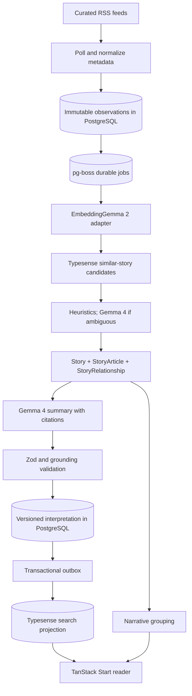

# 005 — Prototype Specification

**Project:** News Intelligence Platform  
**Version:** v0.3  
**Date:** 2026-10-10  
**Status:** Implementation handoff — scoped first vertical slice  
**Companion documents:** `news-intelligence-architecture-v0.3.md`, `news-intelligence-infrastructure-v0.1.md`, `news-intelligence-application-stack-v0.1.md`, `news-intelligence-frontend-platform-v0.3.md`

> **Implement a working web-only prototype, not the full product.** Follow the approved domain model and architectural invariants in the companion documents. If a detail is not specified, choose the smallest reversible implementation and document the decision. Do not replace agreed components with superficially simpler alternatives.

## 1. Objective and demo outcome

Demonstrate an end-to-end, evidence-linked news experience: ingest real or fixture RSS items from a **small curated set of 20–30 publishers**, normalize and deduplicate articles, record immutable observations, generate local embeddings, conservatively associate articles with publishable **Stories**, produce an AI-generated source-linked summary, link related Stories into a **Narrative**, and browse/search the results through a thoughtfully designed TanStack Start web UI.

**Definition of done:** A developer can provision/run the app locally from documented commands, exercise the entire pipeline with deterministic fixtures without a GPU, optionally point it at the remote inference node, and navigate a working Story page with sources and a small branching Narrative history. The prototype should be deployable via Docker Compose on an existing Linux VM.

### Scope at a glance

| Implement in prototype | Lightweight demonstration only | Explicitly defer |
| --- | --- | --- |
| RSS ingestion, metadata, publisher/feeds, observations | Context popovers, outbound primary-source links | Full Claims/Evidence Graph and verification |
| Conservative story grouping and story-to-story links | Provisional publisher metadata / rudimentary coverage view, if seed data supports it | Automated global political-bias classification |
| Local embedding + Gemma-compatible generation adapters | Small Narrative graph/history UI | Personal Blindspots / reading-profile engine |
| Versioned AI summaries and source references | Responsive mobile-viewport behavior | Native mobile apps, auth, billing, notifications |
| Postgres, pg-boss, Typesense + outbox indexing | Search filters / simple hybrid retrieval | Extensive historical backfills and optimization |
| Web feed, Story detail, Narrative detail, search | Basic internal operations/queue status | Sophisticated claim adjudication, cross-country analysis |

Focus on one complete vertical slice before adding more features.

## 2. Non-negotiable architecture decisions

1. **Story is the canonical publication unit.** A Story requires **at least one linked source Article** before it can be published.
2. **Narratives group Stories.** Stories represent discrete developments; use directional, typed Story relationships to model chronological branches and related developments. Avoid eager over-merging. Support reversible merge/split semantics in the domain model; a full editorial merge/split UI is deferred.
3. **Observations are immutable** and represent what the system encountered, not automatically what is true. AI outputs are interpretations grounded in observations. Generated summaries are editable via versioning/supersession, never silent overwrite.
4. **Do not persist full third-party article bodies** in Postgres, Typesense, job payloads, logs, or backups. Always provide RSS headline/description to analysis; optionally process transient article bodies **only if publisher policy permits**. Model this as an explicit, conservative publisher-level permission/policy (e.g. `articleBodyProcessingPolicy: 'metadata_only' | 'transient_body_allowed'`, default `metadata_only`). A boolean may be used internally, but a named policy is clearer and extensible. Source permissions must be verified rather than assumed. Temporary bodies stay out of durable queues and observability. This reduces retention risk, **not** all copyright/licensing risk.
5. **Postgres owns canonical state.** Typesense is a replaceable search/vector projection, updated through a transactional outbox with idempotent consumers and rebuild tooling. Use `pgvector` only where its relational capabilities are useful, not as a competing search source of truth.
6. **pg-boss** owns durable jobs. Queue workers run separately from web. Use bounded concurrency, retries, idempotency, priorities, and backpressure. Backfill must be throttleable/pausable, and fresh news must retain capacity.
7. **Inference is local by default:** EmbeddingGemma 2 for embeddings and a selected Gemma 4 variant for generation, extraction, and classification. A frontier/cloud provider is an optional disabled stub; there is no dedicated decision model. GPU node is stateless with respect to domain data and job ownership.
8. **Web-only prototype:** TanStack Start + Router + Query + React DOM with SSR where appropriate. Future mobile is **Expo + React Native** for iOS/Android, with intentionally separate native UI. **All future-mobile-facing product operations use ordinary typed HTTP endpoints**, not TanStack Start server functions as their exclusive entry point. Shared Zod contracts, TypeScript clients, query definitions and domain logic must be portable to React Native.
9. Deploy with **Docker Compose** on an application VM on existing Hetzner bare metal; remote GPU inference is a separately deployable service over a private encrypted link. OpenTofu for future infrastructure provisioning, Ansible for host configuration; do not make either a blocker for local development.

## 3. Engineering conventions and design-system baseline

### Biome: mandatory from first commit

Use **Biome** for formatting and linting; do not add ESLint or Prettier. Set **2-space indentation** and **no JavaScript/TypeScript semicolons**. Check in the config and wire up root scripts and CI checks. Example initial `biome.json` (validate against the installed Biome version before committing):

```json
{
  "$schema": "https://biomejs.dev/schemas/2.0.0/schema.json",
  "formatter": {
    "enabled": true,
    "indentStyle": "space",
    "indentWidth": 2
  },
  "javascript": {
    "formatter": {
      "semicolons": "asNeeded"
    }
  },
  "linter": {
    "enabled": true
  },
  "assist": {
    "actions": {
      "source": {
        "organizeImports": "on"
      }
    }
  }
}
```

The schema URL and optional rules should match the actual pinned Biome release; the durable requirements are 2 spaces, no unnecessary semicolons, and Biome as the only formatter/linter. Root scripts should include `format`, `lint`, `check`, `typecheck`, `test`, and `build` (names can be adapted consistently).

### Design tokens: mandatory from first UI commit

Create a central `packages/design-tokens/` package or equivalent with a **`design-tokens.css`** file loaded globally by the web app. Use semantic CSS custom properties rather than scattering hard-coded values through components. Initial values are deliberately provisional and easy to revise. Define, at minimum:

- **Colors:** canvas/surface/elevated/background, text primary/secondary/muted, borders, accent/interactive, success/warning/error, focus ring, and graph/coverage visualization palette. Political-coverage colors are **data-visualization tokens**, not universal judgments of truth or credibility.
- **Typography:** font families, scale, weights, line heights; reading-specific measure and spacing.
- **Spacing and layout:** spacing scale, content widths, gutters, breakpoints (documented constants if not expressible as custom-media CSS), safe-area handling.
- **Shape and motion:** radii, borders, shadows, duration and easing; support `prefers-reduced-motion`.
- **Modes:** create a structure that can support light/dark themes later, without requiring both polished variants in this first prototype.

Starter shape (values illustrative, not design sign-off):

```css
:root {
  --color-canvas: #f8f8f6;
  --color-surface: #ffffff;
  --color-text: #1d2322;
  --color-text-muted: #69716e;
  --color-border: #dfe4df;
  --color-accent: #2e7264;
  --space-1: 0.25rem;
  --space-2: 0.5rem;
  --space-3: 0.75rem;
  --space-4: 1rem;
  --space-6: 1.5rem;
  --radius-sm: 0.375rem;
  --radius-md: 0.75rem;
  --radius-lg: 1.25rem;
  --content-max: 76rem;
  --reading-max: 44rem;
}
```

Components should reference tokens (or mappings defined in the shared design system); avoid anonymous magic colors, radii and spacing. Future Expo apps can consume a typed representation of the same design decisions; **do not require DOM/CSS component reuse with React Native**. Provide Playroom as the required independent component playground; it must share design tokens and fixture components with the app.

### Styling system, Base UI, and Playroom (required)

- Use **Tailwind CSS v4** for styling, with semantic tokens in `design-tokens.css` mapped through `@theme`. Token values are provisional, not final brand decisions.
- Use **Base UI** for accessible interaction primitives; create our own distinctive editorial components. **Do not use shadcn/ui** or adopt its default card/dashboard language.
- Install and configure **`seek-oss/playroom`** as a development-only React component playground from the outset, with a root `playroom` script, token/styles integration, light and dark structural support if practical, and typed fixture snippets for Story cards, source attribution, contextual popovers and small narrative UI elements. **Smoke-test Base UI interactions and Tailwind v4 styles in Playroom** before relying on it for development. Do not add Storybook.
- Agents should introduce new reusable presentation components through Playroom fixtures, check narrow/desktop layouts, and then integrate them into app routes.
- **Build a small original reusable component foundation early:** As recurring needs appear, implement `Button`, `IconButton`, `TextInput`, `Textarea`, `Card`, `Badge`, `Popover`, `Tooltip`, and similar components in `packages/ui` (or equivalent), with shared, composable APIs. Do not duplicate button/input/card styling across pages. Prefer Base UI for accessible behaviors; not every purely presentational component requires a Base UI primitive.
- **Keep generic primitives independent of news-domain data.** Build editorial Story/Source/Narrative components on top of the shared primitives. Avoid a sprawling, speculative design system or dozens of unused variants.
- **Iterate in Playroom before page integration:** Provide typed, deterministic examples demonstrating relevant variants, loading/disabled/error and focus states, keyboard/touch behavior, and narrow/desktop layouts. Refine primitives centrally so visual improvements affect all consuming pages.


### Visual anti-pattern guardrails (required)

The prototype should **not lock in a final design language or brand palette**; the founder will choose color and visual identity later. Nevertheless, it should consciously avoid generic AI-generated SaaS styling. In particular:

- No ubiquitous purple gradients, neon/rainbow palettes, or arbitrary multicolor decoration.
- No decorative/pulsing badges without meaningful state; avoid repetitive pill/fingernail-card shapes purely for decoration.
- No gratuitous emoji icons, glassmorphism, fake terminal/tech decorations, or generic landing-page-style dashboards.
- No monotonous default typography choices by inertia; choose a restrained, readable interim editorial type hierarchy, exposed as tokens.
- No sloppy alignment, arbitrary spacing, redundant explanatory labels, or empty marketing taglines such as “Elevate your experience.”
- Prefer editorial clarity, strong typographic hierarchy, clean information density, restrained color, accessible contrast, and purposeful interactions.

These are **anti-patterns, not blanket prohibitions**: a gradient, colored badge or rounded card is acceptable when it has a specific communicative function. Reference: https://godobject.dev/blog/10-tells-of-slop/ (September 27, 2026).

### Responsive, desktop-first

The prototype's primary design target is **desktop**, but every UI feature must remain **usable** at narrow mobile widths. No fixed-width page layouts, accidental horizontal scrolling, hover-only essential controls, inaccessible tiny targets, or charts/graphs that become completely unusable on touch screens. Use mobile-aware composition (stacking, overflow management, appropriate line length) from the outset. Test at approximately **375px**, **768px**, and **1440px** viewports, plus keyboard navigation. The prototype need not have highly polished mobile visuals; it must avoid structural dead ends.

## 4. Product flows and pages

**A. Feed (`/`)** — Desktop-first, well-designed list/grid of published Stories. Show title, concise AI summary, time, source count, identifiable source links, and navigable related Narrative where applicable. Empty/loading/error states must work.

**B. Story (`/stories/:id-or-slug`)** — Canonical publishable content. Render short, source-linked AI summary (a configurable bullet vs paragraph display can be deferred; keep summary representation flexible), links to original reporting, observed/updated times, related Stories, optional background/context popovers and discovered primary-source URLs. Surface source grounding and distinguish observed reports from confirmed facts. No reproduced article bodies.

**C. Narrative (`/narratives/:id-or-slug`)** — Group associated Stories into an understandable timeline / modest branching visualization. Support navigating to individual Story nodes. The graph need only handle a small sample well; avoid complex large-graph performance work.

**D. Search (`/search`)** — Query Stories/Narratives from Typesense (keyword + semantic capability), with functional loading/empty states. Keep internal index schema reconstructible from Postgres. Basic source/time filters are optional.

**E. Operations (internal or dev-only)** — Inspect feeds, recent ingestion status, pending/failed jobs and stage completion. This can be a simple diagnostics page or CLI; do not build a production admin product.

Prefer a strong but restrained design, excellent typography, usable source-link affordances, and consistent tokens to elaborate decorative functionality.

## 5. Pipeline and failure behavior



**Progressive bootstrap:** (1) ingest metadata and observations; (2) batch embeddings; (3) conservatively assemble Stories; (4) summarize only selected/recent/important Stories; (5) defer deeper context, claims, provenance and narrative enrichment. Backfill should be controlled by a producer/rate limit; do not enqueue tens of thousands of full inference jobs in a burst.

**Priorities:** `interactive`, `fresh`, `backfill`, with simple bounded worker allocation so backfill cannot starve fresh news. Initially use fixed caps and easy configuration, not sophisticated scheduling. Separate embedding and generation limits. Jobs are retryable, deduplicated by task/target/input fingerprint/pipeline version, expire/reprioritize when stale, and cannot publish a result for an obsolete input version.

**Failures:** RSS errors are isolated per feed; duplicates do not create redundant articles or jobs; GPU outage queues work while published content remains available; invalid Zod output is retried/flagged, not silently published; indexing failures retry from the outbox; search indexes can be rebuilt; a permanently failed job remains inspectable. Never leak transient source bodies into error reporting.

## 6. Initial AI contracts

Define schemas in `packages/schemas` with Zod. Their exact fields may evolve, but build a small stable starter set:

```ts
import { z } from 'zod'

export const storyMatchSchema = z.object({
  decision: z.enum(['same_development', 'related_development', 'unrelated', 'uncertain']),
  evidenceArticleIds: z.array(z.string()),
  rationale: z.string(),
})

export const storySummarySchema = z.object({
  headline: z.string(),
  summary: z.string(),
  sourceArticleIds: z.array(z.string()).min(1),
  observationIds: z.array(z.string()).min(1),
})

export const contextEntrySchema = z.object({
  title: z.string(),
  explanation: z.string(),
  sourceObservationIds: z.array(z.string()).min(1),
})
```

Define similarly small contracts for article metadata extraction, relationship candidates and source-reference discovery. Enforce that referenced IDs exist and that source evidence is actually linked to the Story being summarized. Structured output validity is **necessary but not sufficient** for factual correctness. Every output records model ID, prompt/pipeline version, input fingerprint, timestamps and grounding associations. Do not use self-reported model confidence as proof.

Inference adapters: `fixture` (mandatory, deterministic, GPU-free) and `local` (EmbeddingGemma 2 + Gemma 4 via remote endpoints); optional `cloud` adapter only as a disabled interface stub. Treat publisher-controlled material and model output as untrusted data. Never allow instructions found in articles or RSS content to alter system behavior.

## 7. Schema / service implementation guidance

Minimum domain tables: `Publisher` (including permitted article-body processing policy), `Feed`, `FeedEntry`, `Article`, `ArticleRevision`, `Observation`, `Story`, `StoryArticle`, `StoryRelationship`, `Narrative`, `NarrativeStory`, `SourceReference`, `Interpretation`, `InterpretationEvidence`, `AnalysisRun`, plus job/outbox-related tables. Implement only immediately necessary fields; follow doc 001 for the full conceptual model. Use Drizzle migrations, database foreign keys and uniqueness constraints. The publish operation must enforce at least one linked Article at the service/transaction boundary (and add stronger DB enforcement if practical).

API endpoints consumed by the web and future Expo clients must be normal versioned JSON HTTP endpoints, for example:

```text
GET /api/v1/stories
GET /api/v1/stories/:id
GET /api/v1/narratives/:id
GET /api/v1/search?q=...
```

Use shared `packages/api-client`, `packages/schemas`, `packages/queries` (TanStack Query options/hooks), and server-only domain services. **Do not make TanStack Start server functions the exclusive interface for mobile-relevant features.** The web can use SSR/prefetching through the same domain services or HTTP handlers. Make sure browser bundles cannot import DB credentials, pg-boss, inference clients or other server-only modules. Keep stable route IDs and URLs for eventual mobile deep links.

Typesense documents should be derived projections (e.g. searchable Story/Narrative title, AI summary, dates, source metadata, embeddings) and can be destroyed/rebuilt. Preserve transactionally inserted outbox events with monotonic aggregate versions; index consumers must tolerate replay and out-of-order delivery.

## 8. Suggested repository layout

```text
apps/
  web/                    # TanStack Start (SSR + client)
  worker/                 # pg-boss ingest/analysis/index workers
  mobile/                 # Not implemented yet; Expo in future
packages/
  db/                     # Drizzle schema and migrations, server-only
  domain/                 # Shared pure domain logic
  schemas/                # Zod API and inference contracts
  api-client/             # Versioned HTTP client; browser/native-safe
  queries/                # TanStack Query definitions
  design-tokens/          # design-tokens.css and token definitions
  ui/                     # Custom web editorial components, Base UI + Tailwind
  inference/              # Fixture/local adapters; server-only
  jobs/                   # Shared queue names and handlers
playroom/                    # Dev-only Playroom config, components and snippets
infra/
  compose/                # Application deployment + local dev
  ansible/                # Optional base VM setup
  tofu/                   # Future provider resources; no blocker
 docs/
  architecture/           # 001-005 docs
```

The `apps/mobile/` directory can be omitted until mobile work begins. Do not implement an Expo app in this prototype.

## 9. Acceptance criteria (testable)

- [ ] `biome.json` committed; 2 spaces, no unnecessary semicolons; root formatting/lint/typecheck commands pass.
- [ ] Tailwind CSS v4 and Base UI are configured; custom components do not import shadcn/ui.
- [ ] Playroom starts with a documented script, renders typed editorial fixtures, loads tokens/Tailwind v4, and supports Base UI interaction smoke tests.
- [ ] Frequently used controls (buttons, text inputs, cards and applicable overlay controls) use original shared components rather than repeated ad hoc implementations; their variants and states are exercised in Playroom.
- [ ] UI avoids the documented AI-slop anti-patterns and preserves a provisional editorial visual direction rather than locking in brand colors.
- [ ] Central `design-tokens.css` exists and is used by layout, typography, colors, spacing and radii; components don't hard-code ad hoc visual constants.
- [ ] Web pages are polished for desktop and usable at ~375px, ~768px and ~1440px; essential interactions support touch and keyboard; no page-wide horizontal overflow.
- [ ] Docker Compose starts web, worker, PostgreSQL and Typesense; clear `.env.example` and local setup instructions included.
- [ ] Deterministic fixture mode runs the entire ingest → embedding/matching → Story → summary → index → UI demo without GPU access.
- [ ] Live RSS mode can ingest a curated, permission-reviewed sample of 20–30 publishers; repeat ingestion deduplicates correctly and captures immutable observations.
- [ ] Metadata-only is the default publisher policy; permitted body text can be processed transiently and is never stored in durable queues, DB, search, app logs, or backups.
- [ ] Story matching is conservative, can return `uncertain`, and related developments can become linked Stories instead of forced merges.
- [ ] A published Story has at least one linked Article and a traceable source-backed, Zod-validated summary.
- [ ] Summary revision/editing creates a new version; previous version remains in history. Stale inference cannot overwrite newer output.
- [ ] Narrative view shows a small branched history with clickable Story nodes.
- [ ] Search uses Typesense projections with embedding retrieval capability; rebuild-from-Postgres works; outbox retries and dedupes.
- [ ] pg-boss worker handles durable retries, pausable/rate-limited backfill and freshness prioritization; GPU unavailability leaves published content accessible.
- [ ] Story, Narrative and search product features use versioned HTTP endpoints callable outside TanStack Start; shared Zod/API client contracts are framework-independent.
- [ ] Automated tests cover key invariants (dedupe, observation immutability, publish-source requirement, version updates, stale jobs, index replay), and basic browser smoke checks verify feed → Story → Narrative → search.
- [ ] README documents what works, what is fixture-only, known limitations, commands for deployment, and specifically deferred features.

## 10. Suggested build sequence

1. Scaffold monorepo, Biome, Tailwind v4, Base UI, design tokens, Playroom, TanStack Start, Drizzle, Docker Compose and fixture-backed HTTP API.
2. Build publisher/feed/article/observation schema, RSS ingestion and repeatable fixture datasets.
3. Integrate pg-boss durable jobs and progressive pipeline; add local inference adapters behind fixture mode.
4. Implement embedding lookup, conservative Story matching, link Stories, version summaries, and source URLs.
5. Implement transactional outbox → Typesense search projections and rebuild operation.
6. Deliver cohesive desktop-first feed, Story, Narrative, and search views using tokens; test responsive use.
7. Add live remote inference smoke test, failure/recovery tests, docs and handoff notes.

**Scope rule:** Prefer a verified end-to-end slice and a convincing, usable frontend over a large collection of unfinished features. If a complex feature threatens completion, keep its canonical data contract and use fixtures, then explicitly mark it deferred.

## 11. Open questions / agent discretion

Implementation agent may select: package manager/workspace tooling, exact database constraints/indexes, initial Story matching thresholds, fixture publisher set, Graph UI library, and exact health-check tooling. Document choices in a short ADR or README note. Do **not** silently change agreed architecture, store full article bodies, expose private inference publicly, introduce a heavyweight orchestration layer, or build native mobile apps.

Model selection/quantization, GPU specifications, final political-assessment rubric, legal feed rights, branding, summary bullet/paragraph preference, real personalization, and billing remain open. Obtain suitable source-use permissions before production ingestion or redistributing generated material.
